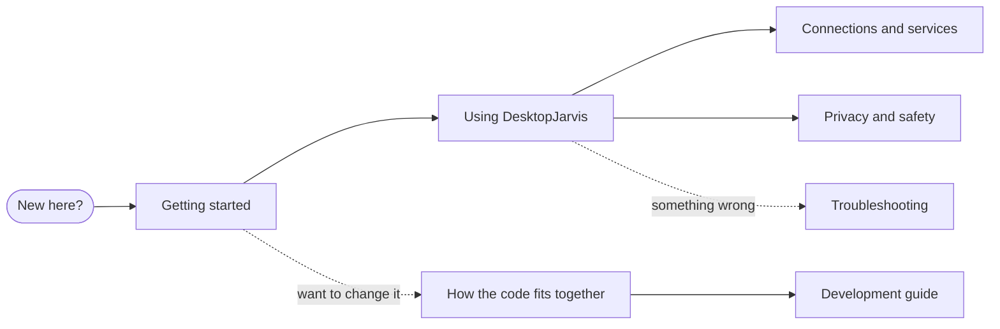

# DesktopJarvis documentation

Start with the guide that matches what you want to do.

| If you want to…                                 | Read                                          |
| ----------------------------------------------- | --------------------------------------------- |
| Install it and have your first conversation     | [Getting started](getting-started.md)         |
| Learn everything you can say and click          | [Using DesktopJarvis](using.md)               |
| Connect mail, calendar, Word, voices and models | [Connections and services](connections.md)    |
| Know what leaves your Mac and what can't happen | [Privacy and safety](privacy-and-safety.md)   |
| Fix something that isn't working                | [Troubleshooting](troubleshooting.md)         |
| Find your way around the code                   | [How the code fits together](architecture.md) |
| Build, change and extend it                     | [Development guide](development.md)           |

Other useful files:

- [`README.md`](../README.md): the short version.
- [`HANDOVER.md`](HANDOVER.md): where the project stands and what is left to do, with the
  details of the planned dragon model in [`TODO.md`](TODO.md).
- [`ACCESSIBILITY.md`](ACCESSIBILITY.md): how DesktopJarvis works with a keyboard, screen
  reader and reduced motion.
- [`CONTRIBUTING.md`](../.github/CONTRIBUTING.md), [`SECURITY.md`](../.github/SECURITY.md),
  [`CODE_OF_CONDUCT.md`](../.github/CODE_OF_CONDUCT.md), kept in `.github/`.
- [`renderer/README.md`](../renderer/README.md): a closer look at the window's code.
