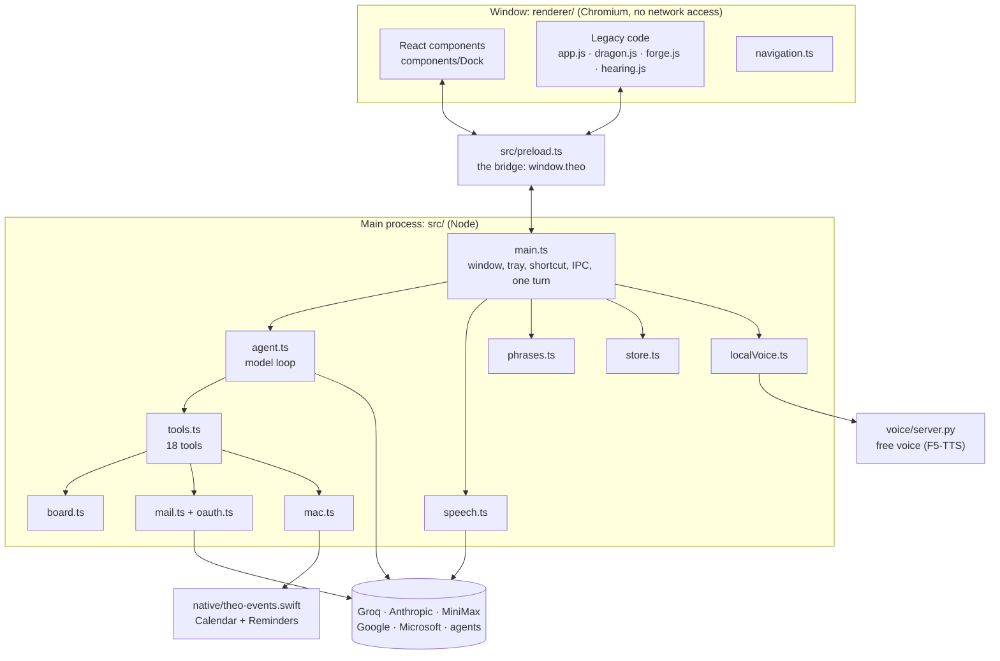
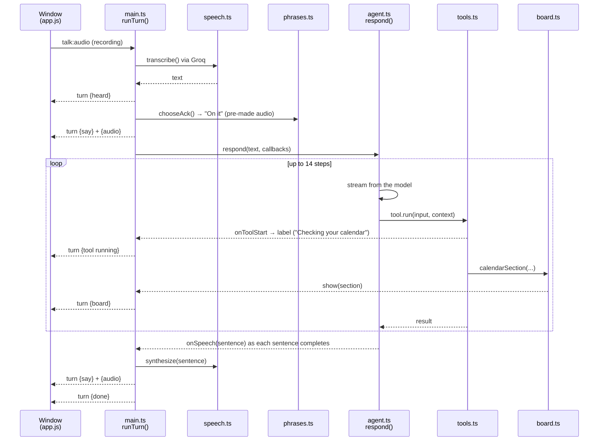
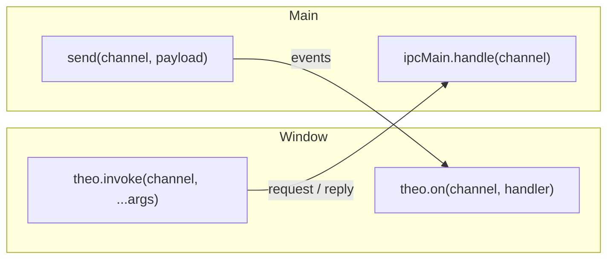
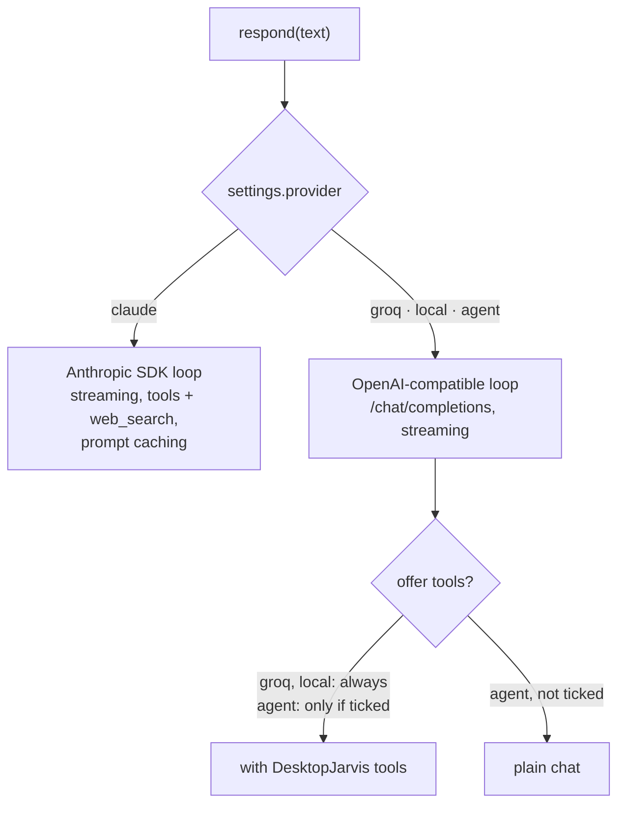
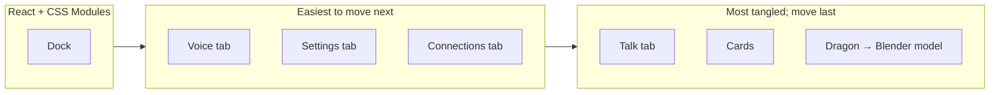
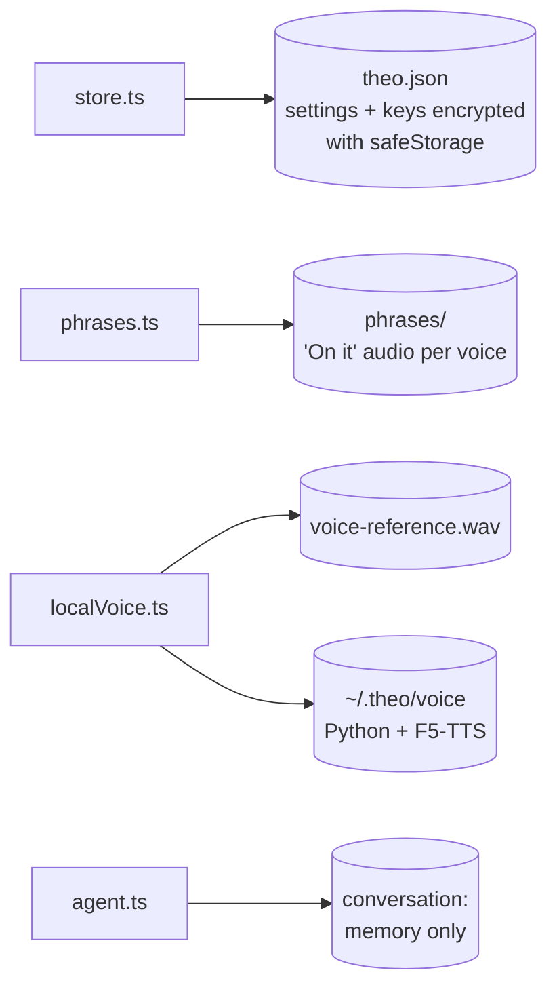

# How the code fits together

DesktopJarvis is an Electron app with two halves: the **main process** (`src/`, Node and
TypeScript), which does all the real work, and the **window** (`renderer/`, React and older
plain JavaScript), which shows it. A small Swift program and an optional Python server help
the main process with things Node can't do.



## Folder map

```
DesktopJarvis/
├── src/                     main process (TypeScript → dist/ via tsc)
│   ├── main.ts              app start, window, menu bar, shortcut, IPC, runTurn()
│   ├── agent.ts             system prompt, conversation history, tool loop per provider
│   ├── tools.ts             every action DesktopJarvis can take
│   ├── board.ts             turns events, reminders, mail and lists into cards
│   ├── speech.ts            Groq transcription, MiniMax speech and cloning
│   ├── phrases.ts           "On it" phrases, and cutting a stream into sentences
│   ├── localVoice.ts        starts and talks to the free voice server
│   ├── mail.ts              Gmail and Outlook APIs
│   ├── oauth.ts             browser sign-in with PKCE, token refresh
│   ├── mac.ts               AppleScript, the Swift helper, shell commands
│   ├── store.ts             settings and encrypted keys (theo.json)
│   └── preload.ts           what the window is allowed to call
├── renderer/                the window (Vite → dist/renderer/)
│   ├── index.html           page skeleton; React mounts into *-root elements
│   └── src/
│       ├── main.tsx         entry: styles, legacy scripts, React roots
│       ├── navigation.ts    current tab, shared by React and legacy code
│       ├── components/      React components with CSS Modules (Dock so far)
│       ├── styles/          global CSS for areas not yet moved to components
│       └── legacy/          original code, being moved into components
├── native/                  Swift EventKit helper (→ native/bin/theo-events)
├── voice/                   free voice: setup.sh and server.py
├── scripts/                 dev server launcher, icon builders
├── assets/                  tray-icon.svg (the animated menu bar dragon)
└── docs/                    you are here
```

## One turn, through the code

This is the most important path in the app: from your voice to its answer.



Things worth knowing about this path:

- **Only one turn runs at a time.** Starting a new one, or pressing Escape, cancels the
  current one through an `AbortController`, and a cancelled turn's events are dropped.
- **Speech is pipelined.** `phrases.ts` cuts the model's stream into sentences, and each is
  sent to be spoken while the next is still being written.
- **The window plays the audio.** The main process sends audio clips as events; the window
  queues and plays them, and uses their loudness to move the dragon's jaw.

## Talking between the halves

The window can't use Node or the network. Everything goes through `window.theo`, defined in
`src/preload.ts`:



| Channel group        | Examples                                                                                                                        | In `main.ts`              |
| -------------------- | ------------------------------------------------------------------------------------------------------------------------------- | ------------------------- |
| Settings and state   | `state:get`, `settings:update`, `secret:set`, `open:external`                                                                   | `registerSettingsIpc()`   |
| Talking              | `talk:audio`, `talk:text`, `talk:cancel`, `talk:warm`, `talk:reset`, `wake:audio`, `confirm:respond`, `reminder:complete`       | `registerTalkIpc()`       |
| Voice                | `voice:clone`, `voice:preview`, `voice:remove`                                                                                  | `registerVoiceIpc()`      |
| Connections          | `connection:connect`, `connection:disconnect`                                                                                   | `registerConnectionIpc()` |
| Main → window events | `turn` (heard, status, tool, board, say, audio, system-voice, error, done), `state:changed`, `shortcut:talk`, `confirm:request` | `send()`                  |

The window may only change the settings listed in `EDITABLE_SETTINGS` and the keys in
`EDITABLE_SECRETS` in `main.ts`.

## Thinking providers

`agent.ts` has two loops behind one `respond()`:



Both keep the conversation in memory (up to 60 messages, then it resets) and allow up to 14
tool steps per turn. The system prompt in `systemPrompt()` is where DesktopJarvis's manner is
defined: short, spoken, no markdown, answer first.

## The tools

Each tool in `tools.ts` is a `TheoTool`: a name, a description and JSON schema for the model,
a `label()` shown and spoken while it runs, and `run()`.

| Tool                    | Does                                    | Through              | Asks first |
| ----------------------- | --------------------------------------- | -------------------- | ---------- |
| `open_app`              | Opens an application                    | `open -a`            |            |
| `open_url`              | Opens a web address in the browser      | `open`               |            |
| `find_files`            | Finds files by name, optionally by kind | Spotlight (`mdfind`) |            |
| `open_file`             | Opens a file, optionally in a given app | `open`               |            |
| `word_new_document`     | New Word document, optionally with text | AppleScript          |            |
| `list_calendar_events`  | Events in a time range, shown as cards  | Swift helper         |            |
| `create_calendar_event` | Adds an event                           | Swift helper         |            |
| `create_reminder`       | Adds a reminder with an optional alert  | Swift helper         |            |
| `list_reminders`        | Open reminders, shown as cards          | Swift helper         |            |
| `complete_reminder`     | Ticks one off                           | Swift helper         |            |
| `list_emails`           | Recent or matching mail, shown as cards | Gmail / Graph API    |            |
| `read_email`            | One email in full                       | Gmail / Graph API    |            |
| `draft_email`           | Saves a draft                           | Gmail / Graph API    |            |
| `send_email`            | Sends                                   | Gmail / Graph API    | Always     |
| `show_cards`            | Puts any list on screen                 | `board.ts`           |            |
| `read_webpage`          | Fetches a page as text                  | `fetch`              |            |
| `current_browser_page`  | The page open in Chrome or Safari       | AppleScript          |            |
| `run_applescript`       | Anything else                           | `osascript`          | By default |

## The window

The window is part-way through a move from plain JavaScript to React:



- **`legacy/app.js`** runs everything not yet moved: talking, the comms log, the cards,
  settings and connections.
- **`legacy/dragon.js`** draws the hologram dragon on a canvas each frame from the app's
  state: the pointer, voice loudness, the phase, and where the fire is going. It is due to be
  replaced by a Blender model; see `TODO.md`.
- **`legacy/forge.js`** draws the jet of fire from the dragon's mouth to each card.
- **`legacy/hearing.js`** decides when someone is talking, for the wake word and tap-to-talk.
- **`navigation.ts`** is the one place that knows which tab is showing, so React and legacy
  code switch tabs the same way, with `showView()`.

The step-by-step recipe for moving an area is in
[`renderer/README.md`](../renderer/README.md#moving-another-area-into-a-component).

## Where data lives



The first three live in `~/Library/Application Support/theo-desktop/`. That folder, the
`~/.theo` folder and the `app.theo.assistant` app id still use the project's old name; renaming
them would make existing installs lose their settings and macOS permissions.
