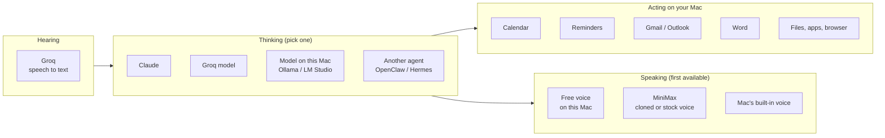
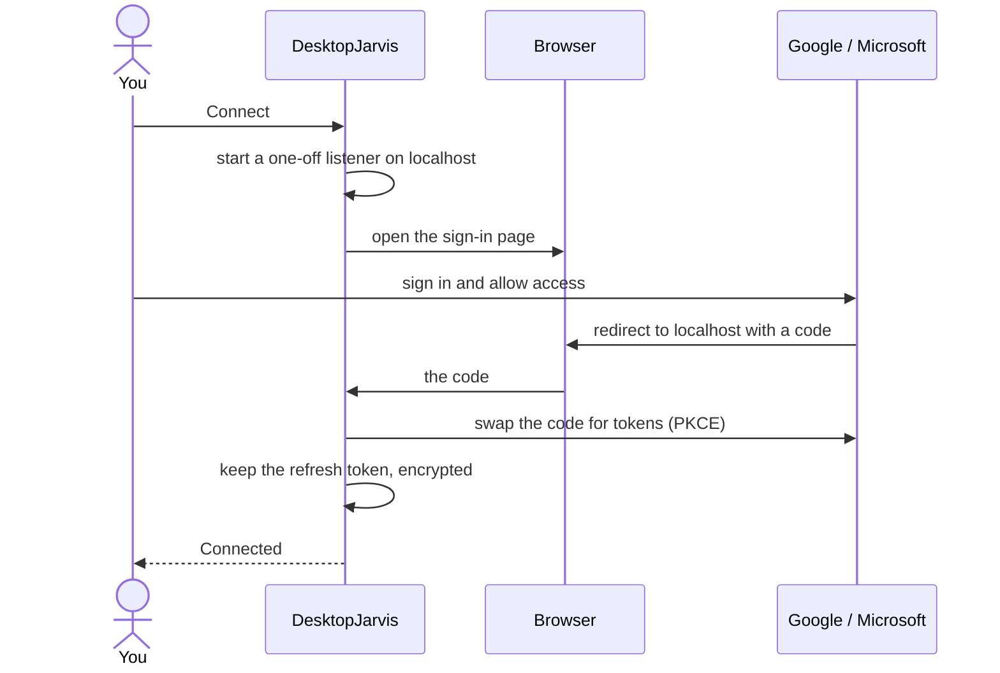
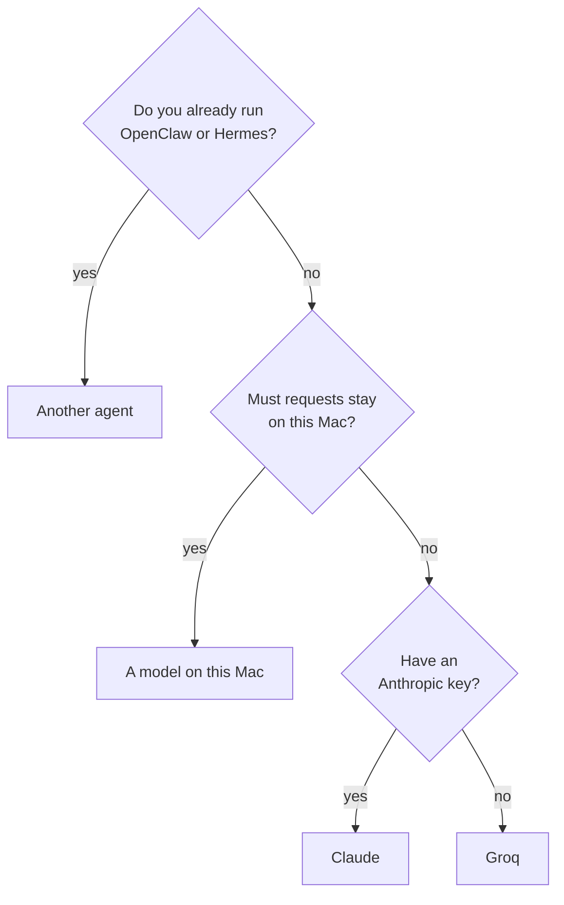
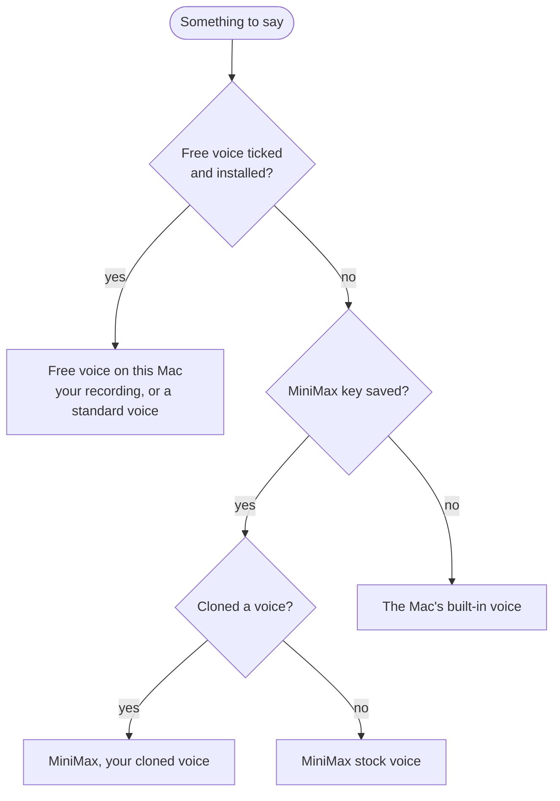

# Connections and services

DesktopJarvis works by combining a few outside services with your Mac's own apps. You choose
which ones to use.



## The Connections tab

| Connection   | What it allows                                                    | Setup                                      |
| ------------ | ----------------------------------------------------------------- | ------------------------------------------ |
| Mac Calendar | Read your schedule and add events, from every account in Calendar | Click Connect, then OK in the macOS prompt |
| Reminders    | Create reminders and read and complete open ones                  | Click Connect, then OK in the macOS prompt |
| Word         | Start new documents and open existing ones                        | Click Connect, then OK in the macOS prompt |
| Gmail        | Read, draft and (with your approval) send email                   | One-time Google setup, below               |
| Outlook      | Read, draft and (with your approval) send email                   | One-time Microsoft setup, below            |

If you said **Don't Allow** to a macOS prompt, turn DesktopJarvis back on in **System
Settings › Privacy & Security** (Calendars, Reminders or Automation).

### Gmail

Google needs you to register DesktopJarvis as your own app. It's free and takes about five
minutes.

1. Open [Google Cloud credentials](https://console.cloud.google.com/apis/credentials) and
   create a project.
2. Enable the **Gmail API** for that project.
3. Set up the **OAuth consent screen** as **External**, and add your own address as a
   **test user**.
4. Create an **OAuth client ID** of type **Desktop app**.
5. Paste its **client ID** and **client secret** into the Gmail row on the Connections tab and
   click **Connect**.

### Outlook

1. Open [Microsoft Entra app registrations](https://entra.microsoft.com/#view/Microsoft_AAD_RegisteredApps/ApplicationsListBlade)
   and choose **New registration**.
2. For supported accounts, pick **any organizational directory and personal Microsoft
   accounts**.
3. Add a redirect URI on the platform **Public client/native (mobile & desktop)** with the
   value `http://localhost`.
4. Paste the **Application (client) ID** into the Outlook row and click **Connect**.

Both sign in through your normal browser:



## Who does the thinking

Choose in **Settings › Thinking**.

| Option                  | Good for                                | Needs                                                                          | Notes                                                                  |
| ----------------------- | --------------------------------------- | ------------------------------------------------------------------------------ | ---------------------------------------------------------------------- |
| **Claude**              | The best results; recommended           | Anthropic key                                                                  | The only option with web search                                        |
| **Groq**                | Fast and free to start                  | Groq key                                                                       | Default model `openai/gpt-oss-120b`; choose one that supports tool use |
| **A model on this Mac** | Privacy; works offline (except hearing) | Ollama (`http://localhost:11434/v1`) or LM Studio (`http://localhost:1234/v1`) | Pick a model trained for tool calling                                  |
| **Another agent**       | Using an agent you already run          | Its address, name and key                                                      | It thinks with its own tools and memory                                |



### Another agent (OpenClaw, Hermes)

DesktopJarvis passes what you say to the agent and speaks its reply. Tick **Also let the agent
use DesktopJarvis's tools** to offer it calendar, reminders, email, Word and files too.

**OpenClaw:**

1. Turn on its OpenAI endpoint in the gateway config and restart the gateway:
   `gateway.http.endpoints.chatCompletions.enabled: true`.
2. Keep the address `http://127.0.0.1:18789/v1` and the name `openclaw/default` (or
   `openclaw/<id>` for another agent).
3. Paste the gateway token as the **Agent key**.

**Hermes Agent:** address `http://127.0.0.1:8642/v1`, with its `API_SERVER_KEY` as the key.

> The gateway token gives full control of that agent. Keep the gateway on this Mac or a
> private network.

## Voices

DesktopJarvis uses the first of these that's available:



### Cloning a voice

On the **Voice** tab, read the passage aloud in a quiet room at your normal pace (thirty
seconds or more is best, ten is the minimum), or choose an audio file. Tick the box confirming
it's your voice or you have permission, then click **Create voice**. **Play current voice**
lets you hear it, and **Go back to the standard voice** removes it.

Only clone your own voice, or someone's who has said yes.

### The free voice on this Mac

An open model (F5-TTS) that speaks and clones voices on Apple Silicon, with nothing sent
anywhere.

```sh
npm run voice:setup   # installs it into ~/.theo/voice; needs Homebrew Python 3.10+
```

Then tick **Speak with the free voice** on the Voice tab. The model (about 1.3 GB) downloads
the first time it speaks. On an 8 GB M1, each sentence takes about as long to prepare as it
does to say. Making a voice from a recording still uses Groq, to transcribe the sample.

> The model's weights are licensed for non-commercial use only.
