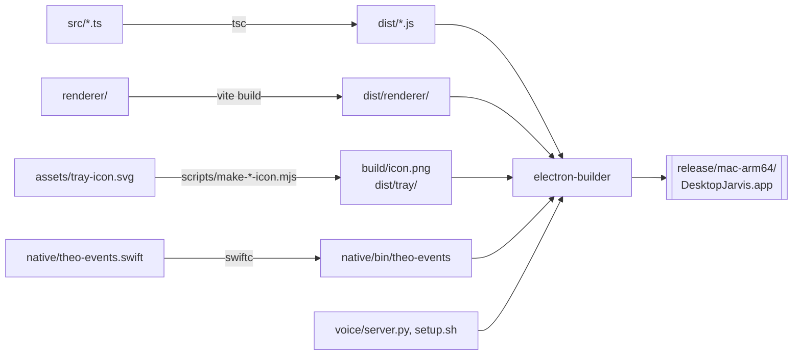
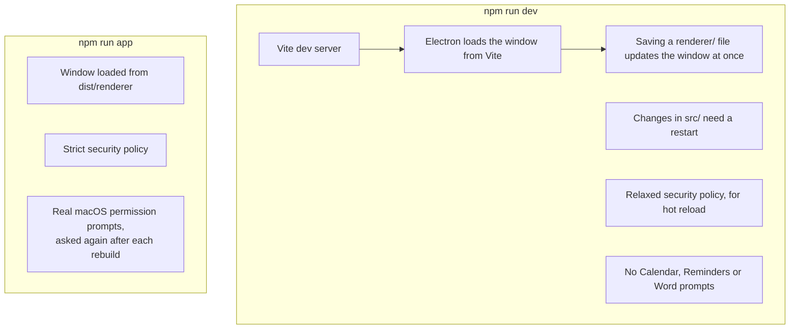
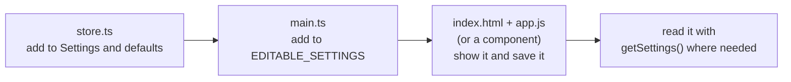

# Development guide

How to build, run and change DesktopJarvis. For the rules on pull requests and commits, see
[`CONTRIBUTING.md`](../.github/CONTRIBUTING.md).

## Commands

| Command                | Does                                                                       |
| ---------------------- | -------------------------------------------------------------------------- |
| `npm run dev`          | Builds the main process, opens the app with the window served live by Vite |
| `npm run app`          | Full build into `release/mac-arm64/DesktopJarvis.app`                      |
| `npm run open`         | Opens the packaged app                                                     |
| `npm run check`        | oxlint, Prettier and both type checks; run before every commit             |
| `npm run lint:fix`     | Applies oxlint's automatic fixes                                           |
| `npm run format`       | Rewrites files in Prettier style                                           |
| `npm run build:icon`   | Rebuilds the app icon and the menu bar dragon from `assets/`               |
| `npm run build:native` | Compiles the Swift Calendar and Reminders helper                           |
| `npm run voice:setup`  | Installs the free voice into `~/.theo/voice`                               |

## How the build fits together



## Dev mode vs the packaged app



Use dev mode for the window and anything not touching the Mac's apps. Use the packaged app
whenever you work on Calendar, Reminders or Word.

## Common changes

### Add something DesktopJarvis can do (a tool)

1. Add an entry to the `tools` array in `src/tools.ts`:

   ```ts
   {
     name: "toggle_dark_mode",
     description: "Switch the Mac between light and dark appearance.",
     input_schema: { type: "object", properties: {} },
     label: () => "Switching the appearance",
     async run() {
       await appleScript(
         'tell application "System Events" to tell appearance preferences to set dark mode to not dark mode',
       );
       return { done: true };
     },
   },
   ```

2. Write the `description` for the model: say when to use it and when not to. It decides
   everything from that.
3. Keep `label()` short and present tense. It is shown in the comms log and may be spoken.
4. Use `context.confirm(...)` before anything that can't be undone or reaches other people.
5. To show results on screen, build a section with `board.ts` and call `context.show(...)`.
6. If it changes what DesktopJarvis can do in general, update the "Acting on the Mac" part of
   `systemPrompt()` in `src/agent.ts`.

Every provider picks up the new tool automatically, except another agent with tools switched
off.

### Change how DesktopJarvis talks

Its manner (short, spoken, answer first, no markdown) is in `systemPrompt()` in
`src/agent.ts`. The quick "On it" phrases and which one fits a request are in
`src/phrases.ts`.

### Add a setting



Keys and tokens go through `setSecret()` and `getSecret()` instead, so they're encrypted, and
the window may only set those in `EDITABLE_SECRETS`.

### Add an IPC channel

1. `ipcMain.handle("area:action", ...)` in the right `register…Ipc()` in `src/main.ts`.
2. Add the channel to `INVOKE` (or `EVENTS`, for main → window) in `src/preload.ts`. The
   bridge refuses anything not listed.
3. Call it from the window with `theo.invoke("area:action", ...)`.

### Change the window

New interface goes in a React component under `renderer/src/components/`, with its own CSS
Module. Use the shared colours and fonts from `renderer/src/styles/base.css`
(`var(--blue)` and so on). To move an existing area out of `legacy/`, follow
[`renderer/README.md`](../renderer/README.md#moving-another-area-into-a-component).

### Change the menu bar dragon

Edit `assets/tray-icon.svg` (open it in a browser to watch the fire flicker), then
`npm run build:icon`.

## Checking your work

There are no automated tests yet. Before committing:

1. `npm run check` passes.
2. You've tried the change in the app: `npm run dev`, or the packaged app for anything
   touching Calendar, Reminders or Word.
3. For visual changes, compare screenshots before and after.
4. Watch the `[theo] turn:` timings in the terminal if you touched the talking path; the
   first audio should still arrive quickly.

## Code style

- TypeScript in `src/`, plain names, comments that explain why.
- oxlint (not ESLint, which doesn't support TypeScript 7 yet) and Prettier, configured in
  `.oxlintrc.json` and `.prettierrc.json`.
- Interface text and errors are written for the person using the app: plain, specific, and
  saying what to do next, such as "Add a Groq API key in Settings so DesktopJarvis can hear
  you. Typing still works without it."
