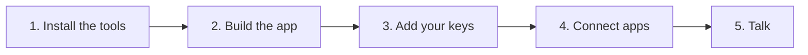

# Getting started

About fifteen minutes from a fresh clone to talking to your Mac.



## 1. What you need

- **An Apple Silicon Mac** (M1 or later). That is what it is built and tested on, and the
  free voice needs one.
- **Node.js** (a current LTS release) and npm.
- **Xcode command line tools**, for the small Swift program that reads Calendar and
  Reminders: `xcode-select --install`.
- **Keys** for the services you want. Only one is needed to get going:

| Key       | What it gives you                      | Without it                                          | Get one                                                |
| --------- | -------------------------------------- | --------------------------------------------------- | ------------------------------------------------------ |
| Anthropic | Claude does the thinking (recommended) | Choose Groq, a local model or another agent instead | [console.anthropic.com](https://console.anthropic.com) |
| Groq      | Hearing you speak                      | You can still type requests                         | [console.groq.com](https://console.groq.com)           |
| MiniMax   | A natural voice, and voice cloning     | It speaks with the Mac's built-in voice             | [minimax.io](https://www.minimax.io)                   |

Groq and Anthropic together give the full spoken experience. MiniMax is optional, and
so is the [free voice that runs on your Mac](connections.md#the-free-voice-on-this-mac).

## 2. Build and open it

```sh
git clone https://github.com/frank-shen-07/DesktopJarvis.git
cd DesktopJarvis
npm install
npm run app     # builds release/mac-arm64/DesktopJarvis.app
npm run open    # opens it
```

A dragon appears in your menu bar and the window opens. The app keeps running in the menu
bar when you close the window; quit it from the dragon's menu.

> **Use the packaged app** (`npm run app`) for everyday use. `npm run dev` is for working on
> the code, and macOS won't show the Calendar, Reminders and Word permission prompts to it.

## 3. Add your keys

Open the **Settings** tab (the dock at the bottom of the window) and paste your keys under
**Service keys**. They are encrypted with your Mac's keychain and only ever sent to the
service they belong to.

## 4. Connect your apps

Open the **Connections** tab and click **Connect** next to what you want DesktopJarvis to
reach. Calendar, Reminders and Word each show a macOS prompt once; say **OK**. Gmail and
Outlook need a short one-time setup, described in
[Connections and services](connections.md#gmail).

## 5. Talk to it

On the **Talk** tab, do any of these:

- **Hold Space**, say your request, and let go.
- **Click the glowing core** in the middle, speak, and pause; it sends when you stop.
- Press **⌥ Space** (Alt+Space) from any app.
- **Type** into "Or type a request".

Try:

- "What's on my calendar tomorrow?"
- "Remind me to call the dentist at four."
- "Anything I need to deal with today?"
- "Open a new Word document."

You'll hear a quick "On it", then the answer, spoken sentence by sentence. Events, reminders
and emails appear as cards that the dragon draws with fire.

Next: [Using DesktopJarvis](using.md) for everything else you can do.
