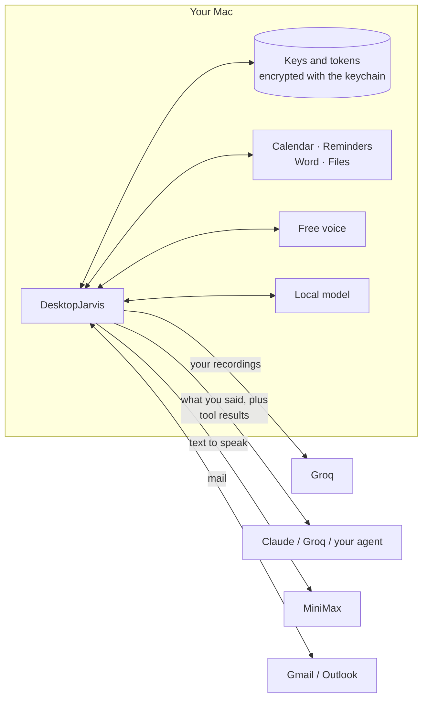
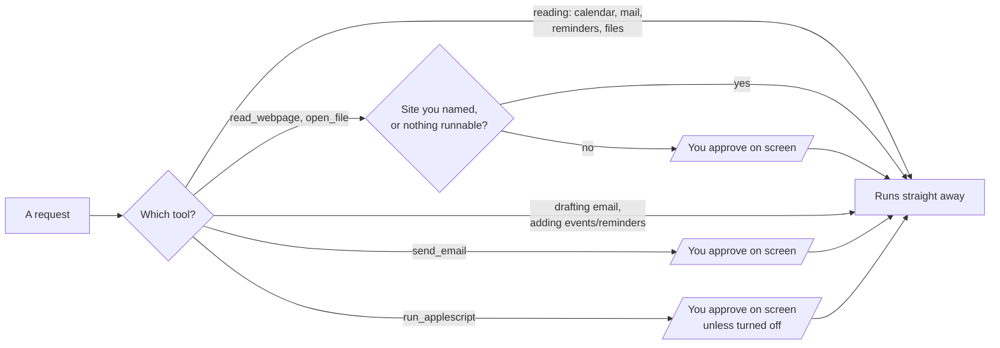

# Privacy and safety

DesktopJarvis can read your mail and calendar and act on your Mac, so it's worth knowing
exactly what goes where.

## What leaves your Mac

| Service              | What it receives                                                                                             | When                           |
| -------------------- | ------------------------------------------------------------------------------------------------------------ | ------------------------------ |
| Groq (hearing)       | Recordings of what you say                                                                                   | Each spoken request            |
| Groq (wake word)     | Short stretches of speech heard near your Mac                                                                | Only while the wake word is on |
| The thinking service | Your request, the conversation so far, and whatever its tools return (events, emails, file names, page text) | Each request                   |
| MiniMax              | The text of each reply; your voice sample, when you clone                                                    | When it's your voice           |
| Gmail / Outlook      | Mail requests from your account                                                                              | When you ask about mail        |

To keep as much as possible on your Mac, choose **A model on this Mac** for thinking and the
**free voice** for speaking. Hearing still uses Groq.

## What stays on your Mac

| What                                    | Where                                                            |
| --------------------------------------- | ---------------------------------------------------------------- |
| Settings, and encrypted keys and tokens | `~/Library/Application Support/theo-desktop/theo.json`           |
| Ready-made "On it" phrases              | `~/Library/Application Support/theo-desktop/phrases/`            |
| Your free-voice recording               | `~/Library/Application Support/theo-desktop/voice-reference.wav` |
| The free voice itself                   | `~/.theo/voice/`                                                 |

Keys are encrypted with Electron's `safeStorage`, which uses your macOS keychain. The
conversation is kept in memory only and is gone when you quit.

## Guard rails

- **Sending email** always needs your approval. It drafts by default.
- **Reading a web page** needs your approval unless it's on a site you named in your request or the page open in your browser, so a page suggested by an email can't quietly carry your data off in its address. Pages on your Mac or local network are never read.
- **Opening something that can run**, such as an app, a script or an installer, or opening a file with Terminal, needs your approval.
- **AppleScript** needs your approval while **Ask me before DesktopJarvis runs a custom script**
  is ticked. The model is also told never to use it to delete files, change security
  settings, or send messages.
- **Text from emails, web pages and files is treated as information, not instructions.** The
  model is told not to follow instructions it finds in them. This lowers the risk of a
  malicious email steering DesktopJarvis, but can't remove it, which is why sending and
  scripts ask first.
- **The window can't reach the internet itself.** Its security policy blocks network access;
  everything goes through the main process, which only talks to the services above.

## Found a problem?

Report security issues privately, as described in [`SECURITY.md`](../.github/SECURITY.md).
