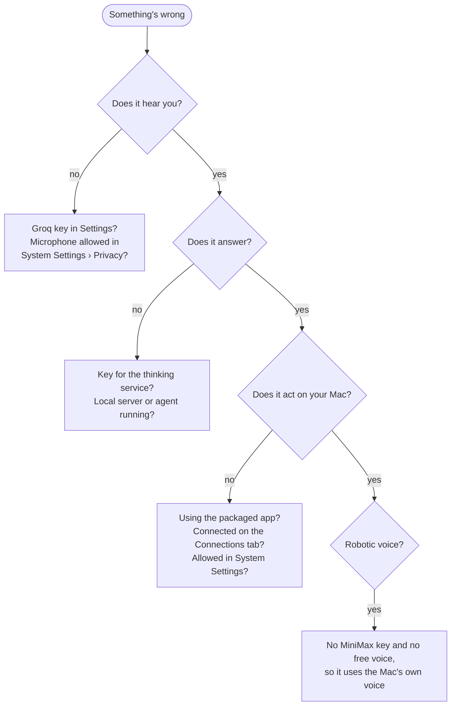

# Troubleshooting

## Quick checks

## Common problems

| Problem                                                           | Why                                                                                               | Fix                                                                                                                                                                   |
| ----------------------------------------------------------------- | ------------------------------------------------------------------------------------------------- | --------------------------------------------------------------------------------------------------------------------------------------------------------------------- |
| "Add a Groq API key in Settings so DesktopJarvis can hear you"    | Speech-to-text uses Groq                                                                          | Add a Groq key, or type instead                                                                                                                                       |
| "DesktopJarvis needs an Anthropic API key before it can answer"   | Claude is chosen but no key is saved                                                              | Add the key, or pick another option under Thinking                                                                                                                    |
| Calendar or Reminders say access was turned off                   | You said Don't Allow to the macOS prompt                                                          | System Settings › Privacy & Security › Calendars (or Reminders): turn DesktopJarvis on                                                                                |
| No permission prompt appears for Calendar, Reminders or Word      | You're running `npm run dev`                                                                      | Use the packaged app: `npm run app && npm run open`                                                                                                                   |
| It asks for permissions again after every rebuild                 | Each build gets a new ad-hoc signature, so macOS treats it as a new app                           | Expected while developing; say OK again                                                                                                                               |
| "Both Gmail and Outlook are connected. Say which account to use." | It can't guess                                                                                    | Say "in Gmail" or "in Outlook"                                                                                                                                        |
| "Google did not return a refresh token"                           | Google sometimes holds back a new token for an app it already trusts                              | Connect again; if it keeps happening, remove DesktopJarvis's access at [myaccount.google.com/permissions](https://myaccount.google.com/permissions) and connect again |
| Gmail sign-in is blocked                                          | Your address isn't a test user on the consent screen                                              | Add it under the OAuth consent screen's test users                                                                                                                    |
| The wake word doesn't trigger                                     | It must come first: "Jarvis, …" or "Hey Jarvis, …"                                                | Start with it, in a quieter room; check the Groq key                                                                                                                  |
| The wake word triggers by mistake                                 | A similar-sounding word at the start of speech                                                    | Choose a less common wake word                                                                                                                                        |
| Local model can't be reached                                      | Ollama or LM Studio isn't running, or the address is wrong                                        | Start it; check the address and the exact model name                                                                                                                  |
| Another agent returns 404 or 405                                  | Its OpenAI-style endpoint is off                                                                  | For OpenClaw, set `gateway.http.endpoints.chatCompletions.enabled: true` and restart it                                                                               |
| Local model never uses tools                                      | The model wasn't trained for tool calling                                                         | Choose one that supports tools                                                                                                                                        |
| Free voice is slow                                                | It runs on your Mac's chip                                                                        | Expected on 8 GB machines; MiniMax is faster                                                                                                                          |
| "No Apple Silicon Python found" during `voice:setup`              | Needs Homebrew Python 3.10+                                                                       | `brew install python@3.11`                                                                                                                                            |
| The menu bar shows the word "DesktopJarvis" instead of a dragon   | The icon wasn't built                                                                             | `npm run build:icon`, or a full `npm run app`                                                                                                                         |
| `npm run app` fails at `swiftc`                                   | Xcode command line tools are missing                                                              | `xcode-select --install`                                                                                                                                              |
| Keys you saved are asked for again after a new build              | Each build has a different ad-hoc signature, so macOS won't let it read keys an older build saved | Run `sh scripts/make-signing-cert.sh` once; later `npm run app` builds are signed with it                                                                             |

## Seeing what it's doing

Start it from a terminal with `npm run dev` to see its logs:

- `[theo] turn: heard after … ms, first audio … ms after that, finished …` for each request.
- `[theo] wake: heard "…", ignored, no wake word at the start` for each stretch the wake word
  listener checked (development builds only).

The window's developer tools are under **View › Toggle Developer Tools** (⌥⌘I).

## Starting over

- **Forget the conversation:** Settings › Forget this conversation.
- **Reset everything:** quit DesktopJarvis and delete
  `~/Library/Application Support/theo-desktop/`. This removes your settings, keys, tokens and
  cloned voice choice.
- **Remove the free voice:** delete `~/.theo/voice/`.
