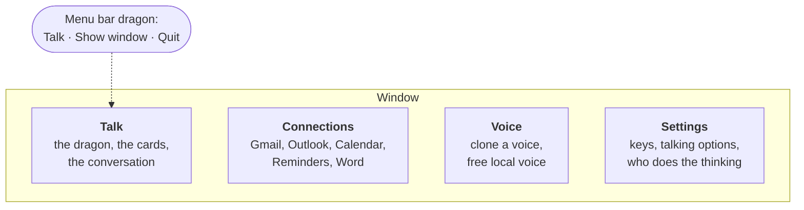
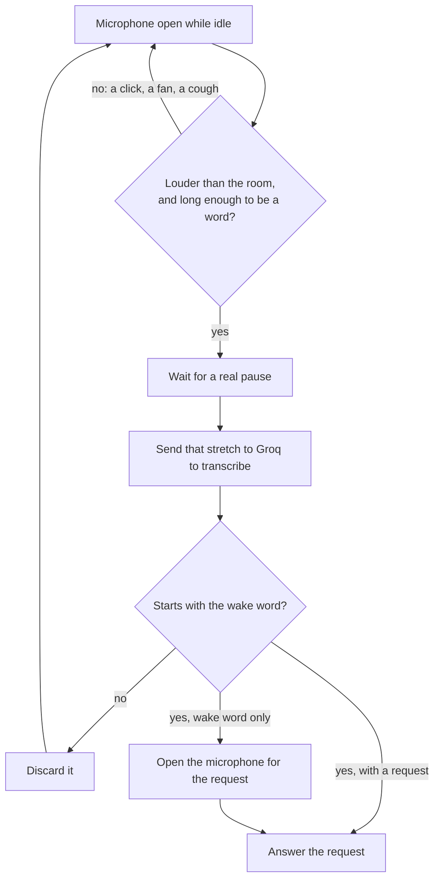
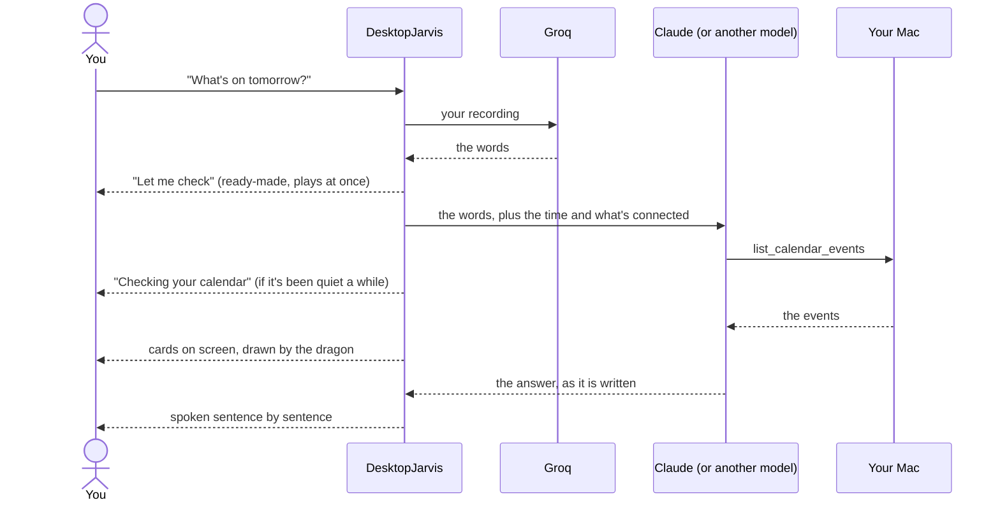
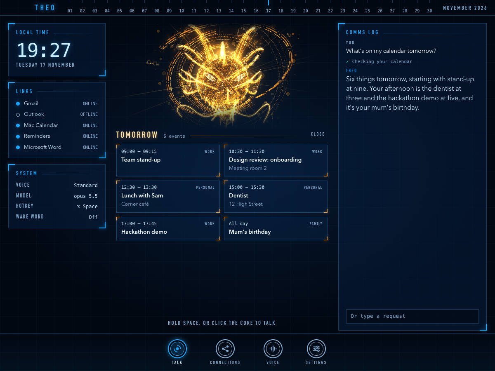

# Using DesktopJarvis

## The window

The window has four tabs, switched with the dock at the bottom.



**Talk** is split in three:

```
┌──────────────┬──────────────────────────────┬────────────────┐
│ Local time   │                              │ Comms log      │
│              │        the dragon            │  what you said │
│ Links        │      (the core: click it)    │  what it did   │
│              │                              │  what it said  │
│ System       │   cards appear here when     │                │
│  voice,model │   there is something to show │ [type here   ] │
│  hotkey,wake │                              │                │
└──────────────┴──────────────────────────────┴────────────────┘
```

The menu bar dragon breathes fire while DesktopJarvis is working. Its menu has **Talk to
DesktopJarvis**, **Show window** and **Quit**.

## Ways to talk

| How                                     | When it sends                            | Needs         |
| --------------------------------------- | ---------------------------------------- | ------------- |
| Hold **Space** on the Talk tab          | When you let go                          | Groq key      |
| Click the **core**                      | When you pause                           | Groq key      |
| Global shortcut (default **⌥ Space**)   | When you pause; works from any app       | Groq key      |
| Say the **wake word** ("Hey Jarvis, …") | When you pause; off until you turn it on | Groq key      |
| Type in **"Or type a request"**         | When you press Return                    | nothing extra |

Press **Escape** to stop it mid-answer, or to put the cards away when it's idle.

### The wake word

Turn it on in **Settings › Talking**. Start your request with the wake word, alone or after
"hey": "Hey Jarvis, what's on today?". If you only say "Jarvis", it opens the microphone and
waits for the rest. The wake word said in the middle of a sentence is ignored.



While the wake word is on, speech near your Mac is sent to Groq to check for it. Anything
without the wake word is thrown away.

## What happens when you ask something



Turn the quick "On it" and the step names off with **Settings › Talking › Answer straight
away…** if you prefer it quieter.

It remembers the conversation, so you can follow up: "And the day after?". Click **Forget
this conversation** in Settings to start fresh. Long conversations are reset automatically.

## What it can do

| Area      | Try saying                                                                          |
| --------- | ----------------------------------------------------------------------------------- |
| Calendar  | "What's on Thursday?" · "Add lunch with Sam at one on Friday."                      |
| Reminders | "Remind me to buy milk at six." · "What's on my list?"                              |
| Email     | "Any new email?" · "Read the one from my landlord." · "Reply saying I'll be there." |
| Files     | "Find my tax spreadsheet." · "Open the trip itinerary PDF."                         |
| Apps      | "Open Spotify." · "Turn the volume down." (via a script)                            |
| Word      | "Start a Word document with a heading called Notes."                                |
| Web       | "Look up the weather in Sydney." · "Summarise the page I'm on."                     |
| Lists     | "Plan my day." · "What should I pack for the beach?"                                |

Behind these are 18 tools, listed in
[How the code fits together](architecture.md#the-tools).

**Web search** is only available when Claude does the thinking. Other models can still read a
page you point them at, or the page open in your browser.

## The cards

Calendar events, reminders, emails and lists DesktopJarvis makes appear as cards under the
dragon, so you can look instead of listen.

- **Tick a reminder** to complete it in the Reminders app.
- **Click an email** to have it read out.
- Press **Escape** or click **Close** to put the cards away.



## Things that ask first

Two actions always show a prompt in the Comms log before they happen:

- **Sending an email.** You see who it's to and what it says. Drafting doesn't ask, and
  DesktopJarvis drafts unless you clearly asked to send.
- **Running a custom AppleScript**, which it uses for things no other tool covers. This one
  can be turned off in Settings, but it's safer to leave it on.

## Settings reference

| Setting                            | Default     | What it does                                                                                          |
| ---------------------------------- | ----------- | ----------------------------------------------------------------------------------------------------- |
| Shortcut                           | `Alt+Space` | Start talking from any app. Leave empty for none.                                                     |
| Listen all the time (wake word)    | off         | Respond to the wake word without pressing anything                                                    |
| Wake word                          | `Jarvis`    | The word that starts a request                                                                        |
| Answer straight away with "On it"  | on          | Quick acknowledgement and step names while it works                                                   |
| Keep listening after it answers    | off         | Carry on the conversation without pressing anything again                                             |
| Ask before running a custom script | on          | Approval prompt for AppleScript                                                                       |
| Who does the thinking              | Claude      | Claude, Groq, a local model or another agent; see [Connections](connections.md#who-does-the-thinking) |
| Claude model                       | Opus 5.5    | Opus (recommended), Sonnet (faster), Haiku (fastest), Fable (most capable)                            |
